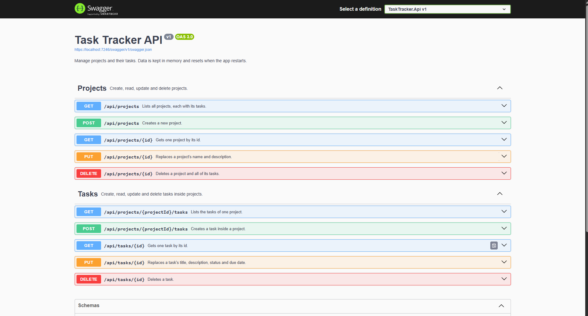

# Task Tracker API

A small REST API for managing **projects** and the **tasks** inside them, built with **ASP.NET Core (.NET 8)** and documented with **Swagger**.




## Tech stack

- .NET 8 / ASP.NET Core Web API (controllers)
- Swagger / OpenAPI (Swashbuckle)
- In-memory data store (a hard-coded `List`, no database needed)

## How to run

### Prerequisites

- [.NET 8 SDK](https://dotnet.microsoft.com/download/dotnet/8.0)
- Optional: Visual Studio 2022 (with the *ASP.NET and web development* workload)

### Option 1: Visual Studio

1. Open `TaskTracker.sln`.
2. Press **F5**. Swagger opens in the browser automatically.

### Option 2: Command line

```bash
git clone https://github.com/zulmajdizainuddin/task-tracker-api.git
cd task-tracker-api
dotnet run --project TaskTracker.Api
```

Then open **http://localhost:5030**. It redirects to Swagger.

> To use HTTPS instead, run `dotnet run --project TaskTracker.Api --launch-profile https` and open **https://localhost:7246**.
> If the browser warns about the certificate, run `dotnet dev-certs https --trust` once.

### Try the requests

- **Swagger:** expand any endpoint, then click **Try it out** and **Execute**.
- **Visual Studio:** open `TaskTracker.Api/TaskTracker.Api.http` and click **Send request** above any request. It covers every endpoint, including error cases.

## Requirements checklist

| Requirement | Status | Where |
|---|---|---|
| .NET 8 Web API with Swagger | ✅ Done | `TaskTracker.Api.csproj`, `Program.cs` |
| In-memory data: hard-coded `List` with at least 2 projects and 4 tasks | ✅ Done (2 projects, 5 tasks) | `Data/SeedData.cs`, `Data/InMemoryTaskTrackerRepository.cs` |
| Models: `Project` and `TaskItem` (with `Status`: Todo / InProgress / Done) | ✅ Done | `Models/` |
| CRUD endpoints for projects (5) | ✅ Done | `Controllers/ProjectsController.cs` |
| CRUD endpoints for tasks (5) | ✅ Done | `Controllers/TasksController.cs` |
| README: how to run and what was completed | ✅ Done | README.md |

## Endpoints

| Method | URL | Description | Success | Errors |
|---|---|---|---|---|
| GET | `/api/projects` | List all projects with their tasks | 200 | — |
| GET | `/api/projects/{id}` | Get one project | 200 | 404 |
| POST | `/api/projects` | Create a project | 201 + `Location` header | 400 |
| PUT | `/api/projects/{id}` | Replace a project's name and description | 200 | 400, 404 |
| DELETE | `/api/projects/{id}` | Delete a project **and all of its tasks** | 204 | 404 |
| GET | `/api/projects/{id}/tasks` | List a project's tasks (`[]` if it has none) | 200 | 404 |
| POST | `/api/projects/{id}/tasks` | Create a task in a project | 201 + `Location` header | 400, 404 |
| GET | `/api/tasks/{id}` | Get one task | 200 | 404 |
| PUT | `/api/tasks/{id}` | Replace a task's title, description, status and due date | 200 | 400, 404 |
| DELETE | `/api/tasks/{id}` | Delete a task | 204 | 404 |

### Example: create a task

```http
POST /api/projects/1/tasks
Content-Type: application/json

{
  "title": "Write homepage copy",
  "description": "Short, friendly text for the hero section.",
  "status": "InProgress",
  "dueDate": "2026-11-10"
}
```

Response: `201 Created`, with `Location: /api/tasks/6` and the new task in the body.

## Rules and validation

- **The server sets** `id` and `createdAt` (UTC). Clients cannot set them.
- **Project name:** required, 1–100 characters. **Task title:** required, 1–200 characters. **Description:** optional, up to 500 characters. Empty or whitespace-only values are rejected.
- **Status:** must be `Todo`, `InProgress` or `Done`, sent as text (not case-sensitive). Numbers such as `2` are rejected. Defaults to `Todo` when creating a task.
- **PUT replaces the whole item:** a field left out of the body is cleared.
- **A task stays in its project:** PUT cannot move it to another project.
- **IDs are never reused** after a delete.
- **All errors** (400, 404, 500) use the standard [ProblemDetails](https://www.rfc-editor.org/rfc/rfc9457) JSON format.

## Sample data

| Project | Tasks |
|---|---|
| 1 - Website Redesign | Create wireframes (Done), Design homepage mockup (InProgress), Build contact form (Todo) |
| 2 - Mobile App Launch | Write app store description (InProgress), Set up push notifications (Todo) |

## Project structure

```text
TaskTracker.Api/
├── Controllers/           ProjectsController, TasksController (HTTP endpoints)
├── DataTransferObjects/   Request and response shapes for the API
├── Data/                  Repository interface, in-memory implementation, seed data
├── Models/                Project, TaskItem, TaskItemStatus
├── Program.cs             Service registration and request pipeline
└── TaskTracker.Api.http   Ready-to-run sample requests
```

## Design decisions

- **Repository behind an interface (`ITaskTrackerRepository`).** Controllers depend on the interface, not the in-memory list, so a database version could replace it by changing one line in `Program.cs`. The methods are `async` for the same reason.
- **Singleton lifetime for the in-memory store.** One shared list lives for the whole app, so data created in one request is visible in the next. A `lock` keeps it safe when requests arrive at the same time.
- **Separate request and response classes (DTOs).** Clients can only send the fields they are allowed to change (no `id` or `createdAt`), and internal model changes don't leak into the API.
- **Nested and flat routes.** Tasks are created and listed under their project (`/api/projects/{id}/tasks`), then accessed directly by their own ID (`/api/tasks/{id}`), as the assignment specifies.
- **Deleting a project deletes its tasks.** A project is treated as a folder of tasks. The alternative would be refusing the delete (409 Conflict) while it still has tasks.
- **The model is called `TaskItem`, not `Task`,** to avoid clashing with .NET's `System.Threading.Tasks.Task`.

## Known limitations

- Data is kept in memory, so it **resets when the app restarts**.
- Data is per app instance: running two copies of the API would give two separate data sets.
- No authentication or authorization (out of scope for this assignment).
- Swagger is only enabled in the Development environment.

## Future improvements

- Replace the in-memory list with a database (SQLite or SQL Server with Entity Framework Core) behind the same repository interface.
- A Blazor page that calls the API.
- Automated tests (xUnit unit tests and integration tests).
- Paging and filtering, e.g. `GET /api/projects/{id}/tasks?status=Done`.
- Authentication with JWT.
- Upgrade to .NET 10 (LTS), since .NET 8 support ends in November 2026.
